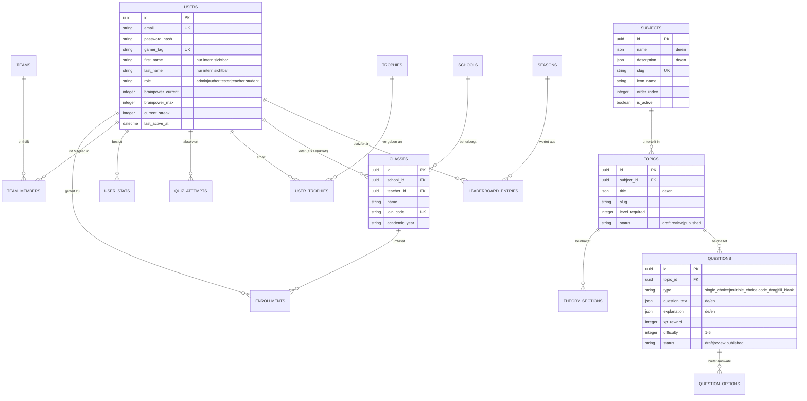

# LearnHarder V2 — Gesamtheitlicher Projektplan, PSP & Risikomanagement

> **Status:** Genehmigter Konzept- & Architekturplan (V2 Neuausrichtung)  
> **Datum:** 11. Oktober 2026  
> **Zielgruppe:** Entwicklungsteam, Schulleitung, betreuende Professoren, Autoren, Lehrkräfte  
> **Architektur-Entscheidung:** Headless Laravel 11 + Filament Admin/CMS (Backend) & Vue 3 + Vite PWA (Frontend) + Nuxt/Astro (SEO Landing Page)

---

## 1. Executive Summary & Zielsetzung

LearnHarder wird von einer statischen Vanilla-Prototypen-Webapp zu einer professionellen, skalierbaren und datenschutzkonformen **Bildungs- und Gamification-Plattform** transformiert. 
Ziel ist es, Schülern und Studenten ein motivierendes, mobiles Lernerlebnis mit hohem Wiedererkennungswert zu bieten, während Lehrkräfte Klassen einfach verwalten und Autoren didaktisch hochwertige Inhalte zweisprachig (Deutsch/Englisch) pflegen können.

### Kernprinzipien des Relaunchs:
1. **Mobile-First & App-Feeling:** Konsequente PWA-Architektur, optimiert für Smartphone-Bedienung mit späterer Desktop-Skalierung.
2. **Pädagogisch fundierte Gamification:** Ersatz heikler Mechaniken (Energydrinks) durch ein intelligentes **Fokus/Brainpower-System** ohne Lernblockaden.
3. **10/10 Datenschutz & DSGVO:** Schülerdaten sind geschützt; öffentliche Bestenlisten nutzen anonyme Gamer-Tags; Hosting erfolgt in der EU (Hetzner).
4. **Modulares Rollen- und CMS-System:** Filament-Adminpanel für getrennte Rechte (Admin, Autor, Tester, Lehrkraft, Schüler).
5. **Zero-Bug-Qualitätskultur:** CI/CD mit automatisierten Unit-, Feature- und Playwright-E2E-Tests vor jedem Staging-Release.

---

## 2. Detaillierte Anforderungsspezifikation

### 2.1 Benutzerrollen & Rechte (RBAC Matrix)

| Rolle | Berechtigungen & Zugriffsbereich | Primäre Oberfläche |
| :--- | :--- | :--- |
| **Super-Admin** | Voller Systemzugriff, Server- & DB-Verwaltung, Rollenzuweisung, Systemlogs, globale Konfiguration | Filament Super-Admin |
| **Redakteur / Autor** | Erstellen, Bearbeiten und Übersetzen von Fächern, Themen, Theorie (Markdown) und Fragen. Status: `Entwurf` oder `In Review`. | Filament Redaktions-Panel |
| **Tester / QA** | Vollzugriff auf unveröffentlichte Inhalte (Review-Status), Staging-Testen, Feedback- & Bug-Reporting-Tools, Test-Accounts mit variablen XP/Stats. | App (Staging-Flag) + Filament Review |
| **Lehrkraft** | Anlegen/Verwalten von Schulklassen, Einladungs-Links/Codes für Schüler, Einsicht in Klassen-Fortschritte, Hausaufgaben/Challenge-Zuweisung (Klarnamensicht). | Lehrkraft-Dashboard (App / Web) |
| **Schüler / Student** | Theorie lesen, Übungen & Quizze absolvieren, Brainpower managen, Teams beitreten, Ranglisten einsehen, Profil/Avatar pflegen. | Mobile PWA (Vue 3) |
| **Gast / Interessent** | Landing Page betrachten, Demo-Lektionen testen, Newsletter abonnieren, Self-Registration. | Landing Page (SEO/Public) |

---

### 2.2 Gamification & Didaktik: Das "Fokus / Brainpower"-System

Das bisherige Energydrink-Konzept weicht dem didaktisch anerkannten **Brainpower-Modell**:

```
┌────────────────────────────────────────────────────────────────────────┐
│                        BRAINPOWER-KREISLAUF                            │
├────────────────────────────────────────────────────────────────────────┤
│ 1. BASIS-ZUGANG:                                                       │
│    Theorie & Standardübungen kosten KEINE Brainpower.                  │
│    -> Lernen wird NIEMALS künstlich gesperrt (Anti-Frust-Garantie).    │
│                                                                        │
│ 2. REGENERATION & KAPAZITÄT:                                           │
│    • Brainpower-Cap (z.B. Start: 100 BP) wächst mit Spieler-Level.     │
│    • Tägliche automatische Aufladung bis zum Cap (z.B. 50 BP / Tag).   │
│    • Tägliche Streaks erhöhen die passive Regenerationsrate.           │
│                                                                        │
│ 3. EINSATZBEREICHE VON BRAINPOWER:                                     │
│    • Prüfungs-Challenges & Zeit-Duelle: Startgebühr in BP              │
│      -> Bei Erfolg: Hohe XP, seltene Trophäen & Abzeichen!             │
│    • Power-Ups: 2x XP-Booster für 30 Minuten aktivieren.               │
│                                                                        │
│ 4. BELOHNUNG & RÜCKTAUSCH:                                             │
│    • Meilenstein-Trophäen können bei Bedarf in BP rückgetauscht werden.│
│    • Trophäen schalten kosmetische Belohnungen (Phase 3) frei.         │
└────────────────────────────────────────────────────────────────────────┘
```

---

### 2.3 Mehrsprachigkeit (i18n), Content-Workflow & KI-Übersetzungshilfe

* **Technik:** Feld-basierte Lokalisierung via `spatie/laravel-translatable` in PostgreSQL / MariaDB.
* **Unterstützte Sprachen:** Standard: `de` (Deutsch), Sekundär: `en` (Englisch), erweiterbar für weitere Sprachen.
* **KI-Übersetzungs-Plugin in Filament:**
  * Autoren verfassen Fragen, Antwortoptionen, Erklärungen und Theorie primär auf Deutsch.
  * Ein integrierter Action-Button (**„Per KI übersetzen"**) ruft die DeepL API (oder OpenAI GPT-4o-mini) auf und befüllt das englische Sprachfeld automatisch mit einer hochwertigen Rohübersetzung.
  * Dies spart bis zu 80 % der Redaktionszeit, während die finale inhaltliche Qualitätskontrolle beim menschlichen Autor/Tester verbleibt.
* **Redaktions-Workflow:**
  1. **Draft (Entwurf):** Autor erstellt Inhalt (DE) und generiert/überprüft Übersetzung (EN).
  2. **Review (Prüfung):** Tester und Fachlehrer prüfen Didaktik und Korrektheit.
  3. **Published (Freigegeben):** Inhalt wird live für Schüler sichtbar geschaltet.
* **Frontend-i18n:** `vue-i18n` synchronisiert statische UI-Texte mit den dynamischen API-Sprachfeldern.

---

### 2.4 PWA-Offline-Scope & Synchronisations-Architektur (Cheat-Prävention)

Um Cheating bei Prüfungen/Ranglisten zu verhindern und gleichzeitig unterwegs eine stabile Nutzererfahrung zu garantieren, wird der Offline-Scope im MVP strikt abgegrenzt:

| Feature / Modul | Offline-Verhalten (Service Worker Cache) | Rationale & Sicherheitsaspekt |
| :--- | :--- | :--- |
| **Theorieblöcke & Zusammenfassungen** | **Vollständig offline lesbar** (sobald einmal geladen/gecacht) | Schüler können in Bus/Bahn oder bei schwachem Netz ohne Unterbrechung Theorie lernen. |
| **Quizze & Übungen** | **Online-Pflicht für Start & Abschluss** | Verhindert Client-Side Manipulation von Antworten, Zeiten und XP-Vergaben. |
| **Netzwerkabbruch während Quiz** | **Pausiert & lokales Zwischenspeichern** | Bricht das Netz mitten im Quiz ab, wird der Zustand im `localStorage` eingefroren. Erst bei Wiederverbindung wird das Ergebnis per Idempotency-Token an die Laravel-API übermittelt. |
| **XP-, Ranglisten- & Streak-Updates** | **Reine Server-Autorität** | Sämtliche Streak- und XP-Zähler werden ausschließlich in der Laravel-DB errechnet und signiert. |

---

### 2.5 Echtzeit-Layer (Laravel Reverb — Phase 2)

Für synchrone Multiplayer-Elemente und Live-Schulbetrieb wird in Phase 2 ein nativer WebSocket-Server integriert:
* **Technologie:** **Laravel Reverb** (skalierbarer First-Party WebSocket-Server für Laravel, nahtlos mit Laravel Echo im Vue-Frontend).
* **Einsatzbereiche:**
  * **1v1 Zeit-Duelle:** Zwei Schüler treten in Echtzeit gegeneinander zu einem 60-Sekunden-Speed-Quiz an (Live-Punkteanzeige des Gegners).
  * **Klassen-Live-Quiz (Kahoot-Modus):** Lehrkraft startet ein Live-Quiz auf dem Smartboard, Schüler antworten synchron auf ihren Handys.
  * **Live-Leaderboards:** Sofortige Ranglisten-Aktualisierung bei Saison-Events ohne Seiten-Reload.

---

## 3. Datenmodell (ERD-Architektur)

Das Datenmodell ist relational, 3NF-normalisiert und bereit zur Abstimmung mit Fachbereichsleitern und Professoren:



---

## 4. Projektstrukturplan (PSP / Work Breakdown Structure)

```
1.0 PROJEKTINITIALISIERUNG & ARCHITEKTUR
├── 1.1 Anforderungskatalog & Pädagogisches Konzept (Brainpower, Didaktik)
├── 1.2 ERD-Datenmodell-Abstimmung (Review mit Professoren/Lehrkräften)
├── 1.3 Sicherheits-, DSGVO- & Hosting-Konzept (Hetzner VPS, SSL, Backups)
├── 1.4 Designsystem-Definition (Tokens, Farben, Mobile-First Komponenten mit Claude)
└── 1.5 Gamification-Ökonomie & Simulationsmodell (Level 1–100, XP/BP-Kurven, Streak-Formeln)

2.0 BACKEND & CMS-PLATTFORM (Laravel 11 + Filament)
├── 2.1 Laravel Core Setup (PostgreSQL/MariaDB, Sanctum Auth, Eloquent)
├── 2.2 Rollen- & Berechtigungssystem (Spatie Permission / Filament Shield)
├── 2.3 Redaktions-CMS (Fächer-, Themen-, Fragenverwaltung, i18n & DeepL/OpenAI-Übersetzung)
├── 2.4 Gamification-Engine (XP-Kurve, Level 1-100, Brainpower-Regeneration, Streaks)
├── 2.5 Schul- & Klassenmodul (Lehrkraft-Verwaltung, Klassen-Join-Codes)
├── 2.6 RESTful API-Endpunkte für Mobile-Client & Web (Idempotency & Cheat-Prävention)
└── 2.7 WebSocket/Echtzeit-Layer (Laravel Reverb für synchrone 1v1-Duelle & Live-Leaderboards)

3.0 FRONTEND- & DESIGN-SYSTEM (Vue 3 + Vite PWA + Scoped CSS)
├── 3.1 Design-Token-Implementierung (CSS Custom Properties aus Claude-Designsystem)
├── 3.2 Atomare UI-Komponentenbibliothek (Buttons, Cards, Modals, Progressbars, XP-Badges)
├── 3.3 Auth- & Onboarding-Flow (Login, Registrierung, Gamer-Tag-Wahl, Klassen-Code)
├── 3.4 Fächer- & Themenansicht (Theorie-Viewer, Level-Gates)
├── 3.5 Interaktive Lernmodi & Quiz-Engine (Sofortfeedback, XP-Animation, Streaks)
├── 3.6 Brainpower-Hub & Power-Up Aktivierung
└── 3.7 Offline-Support & PWA-Cache (Theorie offline gecacht, Quiz-Abschlüsse online-verifiziert)

4.0 LANDING PAGE & WACHSTUM (Nuxt/Astro SEO-Engine)
├── 4.1 Modernes Landing Page Layout (Mobile & Desktop, hohe Conversion)
├── 4.2 Interaktive Feature- & Gamification-Showcases
├── 4.3 Newsletter-Anbindung & DSGVO-Double-Opt-In
└── 4.4 10/10 SEO-Optimierung (OpenGraph, Schema.org, Lighthouse Performance 95+)

5.0 QUALITÄTSSICHERUNG, DEPLOYMENT & BETRIEB
├── 5.1 Test-Suite (Pest Backend Tests, Vitest Frontend Tests)
├── 5.2 Playwright E2E-Tests (End-to-End Quizlauf, Auth, Klassenbeitritt)
├── 5.3 CI/CD GitHub Actions Pipeline (Linting, Tests, Build-Automation)
├── 5.4 Staging-Umgebung für Tester-Rolle
└── 5.5 Production-Rollout auf Hetzner Cloud (Docker, Caddy/Nginx, tägliche Backups)
```

---

## 5. Meilensteine & 3-Phasen-Releaseplan

### Phase 1: MVP (Minimum Viable Product) — Fokus: Fundament & Kernlernen
* **Ziel:** Vollständig nutzbare Lernplattform auf dem Smartphone für Testklassen und Autoren.
* **Lieferumfang:**
  * Mathematisch austariertes Ökonomie-Modell (Level 1–100, BP-Regeneration).
  * Laravel Backend mit Sanctum & Rollen (Admin, Autor, Tester, Schüler).
  * Filament CMS für Fächer, Theorie und Multiple-Choice-Fragen inklusive **KI-Übersetzungshilfe (DeepL/OpenAI)**.
  * Vue 3 Mobile PWA mit modernem Claude-Designsystem (Tokens + Scoped CSS).
  * PWA-Offline-Caching für Theorie; Online-Validierung für Quizze & XP-Vergabe.
  * Fokus/Brainpower-Logik (Aufladung, Challenge-Kosten, XP).
  * Landing Page mit Registrierung & Newsletter.
  * CI/CD & Staging auf Hetzner.

### Phase 2: V1.0 Launch — Fokus: Schule, Teams & Internationalisierung
* **Ziel:** Offizieller Schulbetrieb mit Lehrkraft-Aufsicht, Klassenranglisten, synchronen Duellen und zweisprachigen Inhalten.
* **Lieferumfang:**
  * Lehrkraft-Dashboard (Klassenanlage, Fortschrittsberichte, Join-Codes).
  * Hybride Teams (Schulklassen Pflicht, private Freundesteams optional).
  * **Echtzeit-Layer (Laravel Reverb):** Synchrone 1v1-Zeit-Duelle und Live-Klassen-Quiz.
  * Monatliche Ranglisten & Saison-Abzeichen.
  * Zweisprachigkeit (DE/EN) für Theorie und Fragen vollständig aktiv.
  * Playwright E2E-Testsuite mit 100% Core-Coverage.

### Phase 3: Ausbaustufe V2.0 — Fokus: Karriere-Modus & Gamification 2.0
* **Ziel:** Langfristige Bindung, Individualisierung und extracurriculare Motivation.
* **Lieferumfang:**
  * Karriere-Modus (Spezialisierungspfade nach Schultypen/Fokus).
  * Spieler-Avatar-System mit freischaltbaren Skins & Abzeichen.
  * Minigames im Browser mit Ingame-Währung (Wissensfunken).
  * Fachübergreifende Quests und Event-Wettbewerbe.

---

## 6. Risikomatrix & Risikomanagement

| ID | Risiko-Beschreibung | Wkt. | Ausw. | Schwere | Gegenmaßnahme & Vermeidungsstrategie |
| :--- | :--- | :---: | :---: | :---: | :--- |
| **R1** | **Datenschutzverletzung minderjähriger Schüler (DSGVO)** | Gering | Hoch | **Hoch** | *Privacy-by-Design*: Öffentliche Leaderboards nutzen ausschließlich Gamer-Tags; Klarnamen sind nur für verifizierte Lehrkräfte in geschlossenen Klassen sichtbar. Server in DE/AT. Cookie-freies Tracking. |
| **R2** | **Pädagogische Ablehnung durch Lehrkräfte / Professoren** | Mittel | Hoch | **Hoch** | Frühzeitige Abstimmung des ERD und didaktischen Konzepts. Vollständiger Verzicht auf Gamification-Paywalls oder erzwungene Lernpausen (Theorie ist immer kostenlos). |
| **R3** | **Content-Engpass (zu wenig Fragen/Themen)** | Hoch | Mittel | **Hoch** | Filament CMS mit integriertem **KI-Übersetzungs-Button (DeepL/OpenAI)** ermöglicht Autoren extrem schnelles Erfassen und zweisprachiges Bereitstellen mit Review-Schleife. |
| **R4** | **Scope Creep / Verzetteln in Minigames & Avatar-Features** | Hoch | Mittel | **Hoch** | Strikte Phasentrennung: Minigames und Avatar-Skins sind fest in Phase 3 verankert. Phase 1 & 2 konzentrieren sich ausschließlich auf die Kern-Lernexperience. |
| **R5** | **Bugs in der XP- und Ranglisten-Logik (Cheat-Gefahr)** | Mittel | Mittel | **Mittel** | Alle XP- und Brainpower-Berechnungen finden serverseitig in Laravel statt (keine Client-Side Manipulation). Quiz-Abschlüsse erfordern zwingend Online-Verbindung mit Idempotency-Tokens. |
| **R6** | **Performance-Verlust auf älteren Smartphones** | Mittel | Mittel | **Mittel** | Kein schweres CSS-Framework; schlankes Scoped CSS; PWA-Assets und Theorie werden offline gecacht; optimierte SVG-Icons statt schwerer Grafik-Assets. Lighthouse Performance > 90. |
| **R7** | **Inkonsistentes UI zwischen Claude-Entwurf und Code** | Mittel | Mittel | **Mittel** | Zentrales Token-Set in CSS (`:root`-Variablen für Palette, Typo, Spacing). Interaktive Komponenten-Showcase-Seite im Frontend zur visuellen Qualitätskontrolle. |
| **R8** | **Hosting-Ausfall oder Datenverlust** | Gering | Hoch | **Mittel** | Automatisierte tägliche Offsite-Backups der Datenbank via Laravel Backup / S3-kompatiblem Storage; automatisches SSL; Container-Health-Checks. |

---

## 7. Sofortige nächste Schritte

1. **Abstimmung:** Vorlage dieses Dokuments bei betreuenden Professoren/Lehrkräften zur Bestätigung von ERD und Brainpower-Konzept.
2. **Ökonomie-Modellierung:** Fertigstellung des Simulationsdokuments [GAMIFICATION_OEKONOMIE_MODELL.md](file:///c:/v/learnharder.app/docs/plans/GAMIFICATION_OEKONOMIE_MODELL.md) zur Abstimmung der XP-Kurven (Level 1–100) und BP-Balancierung.
3. **Design-Token Extraktion:** Übernahme der Tokens aus dem mit Claude erstellten Designsystem in die zentrale CSS-Token-Datei.
4. **Repository-Struktur vorbereiten:**
   * `/backend` (Laravel 11 API + Filament + Reverb)
   * `/frontend` (Vue 3 + Vite Mobile PWA)
   * `/landing` (Astro/Nuxt SEO Page)
5. **Sprint 1 Start:** Backend-Migrations für das ERD und Auth/RBAC einrichten.
